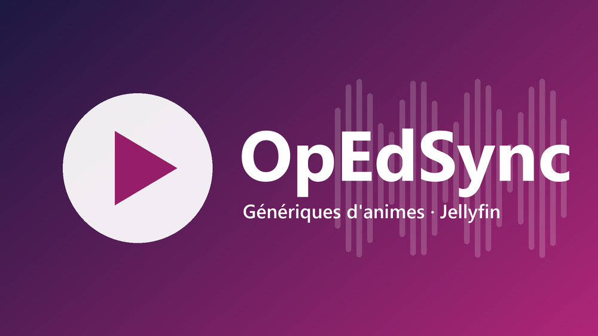

<h1 align="center">🎵 OpEdSync</h1>

<p align="center">
  
</p>

<p align="center">
  
  
  
  
  
  
  
</p>

<p align="center">
  <b>The opening of your favourite anime, as soon as you open its page.</b><br>
  <i>Le générique de vos animés préférés, dès que vous ouvrez leur page.</i>
</p>

---

<p align="center">
  <b>🌐 Language / Langue</b><br>
  <a href="#english">English</a> | <a href="#français">Français</a>
</p>

---

<a name="english"></a>
# English

> 📖 **Changelog and version history:** see [GitHub Releases](https://github.com/ElieMFR/OpEdSync/releases) for what's new in each version.

## 📑 Table of Contents

- [Quick Start](#-quick-start)
- [Key Features](#-key-features)
- [Installation](#-installation)
- [Configuration](#%EF%B8%8F-configuration)
- [Troubleshooting](#-troubleshooting)
- [Recommended Theme](#-recommended-theme)
- [Authors and Credits](#-authors-and-credits)

## 🚀 Quick Start

1. Add the repository and install **OpEdSync** from the Catalog, then restart Jellyfin: see [Installation](#-installation).
2. In **Dashboard → Plugins → OpEdSync**, tick your **anime libraries** and **Save**.
3. Click **Run now**.
4. In your profile, **Display → Theme songs**: turn it on.

Open an anime: its opening plays in the background. The dashboard at the top of the settings tells you how many series have a theme, and why the others don't.

## ✨ Key Features

*   **Openings and endings from [AnimeThemes](https://animethemes.moe)**: the community database of anime themes, as theme music and, if you want it, as theme video.
*   **The right season**: a series gets the theme of its latest season known to AnimeThemes, and falls back to the previous one when a season has nothing yet.
*   **Clean versions first**: themes without on-screen credits or episode overlap are preferred. Simple transitions are accepted only when there is nothing cleaner.
*   **Three ID sources**: AniDB, MyAnimeList or AniList, whichever your metadata plugins provide.
*   **Wrong matches ruled out**: an anime whose release year is far from the media's is ignored, so a western film with a wrong ID does not get an anime theme.
*   **A dashboard that explains itself**: coverage, items without theme with the reason for each (no ID, not on AnimeThemes, no video yet, ruled out), last and next run.
*   **Your files are safe**: the plugin only ever touches the files it wrote, your own `theme.mp3` stays.
*   **Android app fix**: in the Jellyfin Android app (built-in player), a video started over the theme music no longer blocks the next one (needs File Transformation).
*   **Bilingual**: French when Jellyfin is in French, English for every other language.

## 📦 Installation

> [!IMPORTANT]
> **Prerequisites:**
> * Jellyfin **12.x**
> * A metadata plugin that gives your anime an **AniDB**, **MyAnimeList** or **AniList** ID (for instance the AniDB plugin). Without an ID, no theme can be found.
> * Optional: the **File Transformation** plugin, for the Android app fix.

### Steps

1. In Jellyfin, go to **Dashboard → Plugins → Repositories** and add:

   ```
   https://raw.githubusercontent.com/ElieMFR/OpEdSync/main/manifest.json
   ```

2. Open the **Catalog**, install **OpEdSync**, then restart Jellyfin.
3. Follow the [Quick Start](#-quick-start).

If the former **AnimeThemes** plugin is installed, uninstall it: both would download the same files.

## ⚙️ Configuration

| Setting | Default | What it does |
|---|---|---|
| **Libraries** | Libraries whose name contains "anim" | Where the plugin looks for series and movies. Only tick anime libraries. |
| **Themes to download** | One (the best) | One, all, or none. |
| **For series, use** | The latest season | Or the series itself, usually season 1. |
| **Openings and endings** | Both | Or openings only, or endings only. |
| **Themes that overlap with the episode** | Accept simple transitions | Or clean themes only, or accept everything. |
| **Volume** | 50 % | Baked into the file. A change applies on the next run. |
| **Theme video** | Off | Animated background on the series page. Takes a lot of disk space. |
| **Check the release year** | On | Rules out most wrong IDs. |
| **Simultaneous downloads** | 1 | Up to 4. 1 spares the AnimeThemes server. |
| **Replace existing themes on every run** | Off | Downloads again and removes the plugin's themes that no longer match the settings. |

The scheduled task **Search for anime themes** runs every 12 hours.

## ❓ Troubleshooting

| Issue | Solution |
|-------|----------|
| **No theme plays** | Turn on **Theme songs** in your profile's display settings. |
| **A series has no theme** | Open the OpEdSync settings: the dashboard gives the reason. "No ID" means your metadata plugins did not identify it. |
| **A western film or series plays an anime opening** | A metadata plugin gave it a wrong ID. Untick that library in OpEdSync, keep **Check the release year** on, and delete the wrong file in its `theme-music` folder. |
| **Every item says "Not analysed yet"** | Click **Run now**: the reasons are filled by the first run. |
| **The volume did not change** | It applies on the next run: click **Run now**. |
| **Android app: videos stop starting** | Install **File Transformation**, then restart Jellyfin. |

## 🎨 Recommended Theme

OpEdSync pairs well with the [**ElegantFin Cinema Edition**](https://github.com/ElieMFR/ElegantFin) theme, a streaming-inspired CSS theme for Jellyfin.

## 👥 Authors and Credits

OpEdSync is maintained by **[ElieMFR](https://github.com/ElieMFR)**.

It is based on [jellyfin-plugin-animethemes](https://github.com/EusthEnoptEron/jellyfin-plugin-animethemes) by **[EusthEnoptEron](https://github.com/EusthEnoptEron)**. Themes come from [AnimeThemes](https://animethemes.moe), maintained by its community.

Bug reports and feature requests are welcome on [GitHub](https://github.com/ElieMFR/OpEdSync/issues).

Released under the [GPL-3.0 License](./LICENSE).

---

<a name="français"></a>
# Français

> 📖 **Changelog et historique des versions :** voir les [Releases GitHub](https://github.com/ElieMFR/OpEdSync/releases) pour les nouveautés de chaque version.

## 📑 Sommaire

- [Démarrage rapide](#-démarrage-rapide)
- [Fonctionnalités](#-fonctionnalités)
- [Installation](#-installation-1)
- [Configuration](#%EF%B8%8F-configuration-1)
- [Dépannage](#-dépannage)
- [Thème recommandé](#-thème-recommandé)
- [Auteurs et crédits](#-auteurs-et-crédits)

## 🚀 Démarrage rapide

1. Ajoutez le dépôt et installez **OpEdSync** depuis le Catalogue, puis redémarrez Jellyfin : voir [Installation](#-installation-1).
2. Dans **Tableau de bord → Extensions → OpEdSync**, cochez vos **bibliothèques d'anime** et **Enregistrez**.
3. Cliquez sur **Lancer maintenant**.
4. Dans votre profil, **Affichage → Thèmes musicaux** : activez-les.

Ouvrez un animé : son générique se joue en fond. Le tableau de bord en haut des réglages indique combien de séries ont un thème, et pourquoi les autres n'en ont pas.

## ✨ Fonctionnalités

*   **Openings et endings depuis [AnimeThemes](https://animethemes.moe)** : la base communautaire des génériques d'animés, en musique de thème et, si vous le voulez, en vidéo de thème.
*   **La bonne saison** : une série reçoit le thème de sa dernière saison connue d'AnimeThemes, et revient à la précédente quand une saison n'a encore rien.
*   **Versions propres d'abord** : les génériques sans crédits à l'écran ni débordement sur l'épisode sont préférés. Les simples transitions ne sont acceptées que s'il n'y a rien de plus propre.
*   **Trois sources d'identifiants** : AniDB, MyAnimeList ou AniList, selon ce que fournissent vos plugins de métadonnées.
*   **Mauvaises correspondances écartées** : un animé dont l'année est éloignée de celle du média est ignoré, un film occidental au mauvais identifiant ne reçoit donc pas de générique d'animé.
*   **Un tableau de bord qui s'explique** : couverture, médias sans thème avec la raison de chacun (pas d'identifiant, absent d'AnimeThemes, pas encore de vidéo, écarté), dernier et prochain passage.
*   **Vos fichiers sont protégés** : le plugin ne touche qu'aux fichiers qu'il a écrits, votre propre `theme.mp3` reste en place.
*   **Correctif pour l'appli Android** : dans l'appli Jellyfin Android (lecteur intégré), une vidéo lancée pendant la musique de thème ne bloque plus la suivante (nécessite File Transformation).
*   **Bilingue** : en français si Jellyfin est en français, en anglais pour toutes les autres langues.

## 📦 Installation

> [!IMPORTANT]
> **Pré-requis :**
> * Jellyfin **12.x**
> * Un plugin de métadonnées qui donne à vos animés un identifiant **AniDB**, **MyAnimeList** ou **AniList** (par exemple le plugin AniDB). Sans identifiant, aucun thème ne peut être trouvé.
> * Facultatif : le plugin **File Transformation**, pour le correctif de l'appli Android.

### Étapes

1. Dans Jellyfin, allez dans **Tableau de bord → Extensions → Dépôts** et ajoutez :

   ```
   https://raw.githubusercontent.com/ElieMFR/OpEdSync/main/manifest.json
   ```

2. Ouvrez le **Catalogue**, installez **OpEdSync**, puis redémarrez Jellyfin.
3. Suivez le [Démarrage rapide](#-démarrage-rapide).

Si l'ancien plugin **AnimeThemes** est installé, désinstallez-le : les deux téléchargeraient les mêmes fichiers.

## ⚙️ Configuration

| Réglage | Par défaut | Rôle |
|---|---|---|
| **Bibliothèques** | Celles dont le nom contient « anim » | Où le plugin cherche séries et films. Ne cochez que les bibliothèques d'anime. |
| **Thèmes à télécharger** | Un seul (le meilleur) | Un, tous, ou aucun. |
| **Pour les séries, utiliser** | La dernière saison | Ou la série elle-même, en général la saison 1. |
| **Openings et endings** | Les deux | Ou openings seulement, ou endings seulement. |
| **Génériques qui débordent sur l'épisode** | Accepter les simples transitions | Ou génériques propres seulement, ou tout accepter. |
| **Volume** | 50 % | Appliqué dans le fichier. Un changement est pris en compte au passage suivant. |
| **Vidéo de thème** | Désactivée | Fond animé sur la page de la série. Prend beaucoup de place sur le disque. |
| **Vérifier l'année de sortie** | Activé | Écarte la plupart des identifiants erronés. |
| **Téléchargements simultanés** | 1 | Jusqu'à 4. 1 ménage le serveur d'AnimeThemes. |
| **Remplacer les thèmes existants à chaque passage** | Désactivé | Retélécharge et supprime les thèmes du plugin qui ne correspondent plus aux réglages. |

La tâche planifiée **Rechercher les thèmes d'anime** tourne toutes les 12 heures.

## ❓ Dépannage

| Problème | Solution |
|-------|----------|
| **Aucun thème ne se joue** | Activez les **Thèmes musicaux** dans les réglages d'affichage de votre profil. |
| **Une série n'a pas de thème** | Ouvrez les réglages d'OpEdSync : le tableau de bord donne la raison. « Aucun identifiant » veut dire que vos plugins de métadonnées ne l'ont pas identifiée. |
| **Un film ou une série occidentale joue un générique d'animé** | Un plugin de métadonnées lui a donné un mauvais identifiant. Décochez cette bibliothèque dans OpEdSync, gardez **Vérifier l'année de sortie** activé, et supprimez le mauvais fichier dans son dossier `theme-music`. |
| **Tout est « Pas encore analysé »** | Cliquez sur **Lancer maintenant** : les raisons sont remplies par le premier passage. |
| **Le volume n'a pas changé** | Il s'applique au passage suivant : cliquez sur **Lancer maintenant**. |
| **Appli Android : les vidéos ne se lancent plus** | Installez **File Transformation**, puis redémarrez Jellyfin. |

## 🎨 Thème recommandé

OpEdSync s'accorde bien avec le thème [**ElegantFin Cinema Edition**](https://github.com/ElieMFR/ElegantFin), un thème CSS pour Jellyfin inspiré des plateformes de streaming.

## 👥 Auteurs et crédits

OpEdSync est maintenu par **[ElieMFR](https://github.com/ElieMFR)**.

Il est basé sur [jellyfin-plugin-animethemes](https://github.com/EusthEnoptEron/jellyfin-plugin-animethemes) de **[EusthEnoptEron](https://github.com/EusthEnoptEron)**. Les génériques viennent d'[AnimeThemes](https://animethemes.moe), maintenu par sa communauté.

Rapports de bugs et demandes de fonctionnalités sont les bienvenus sur [GitHub](https://github.com/ElieMFR/OpEdSync/issues).

Publié sous [licence GPL-3.0](./LICENSE).
